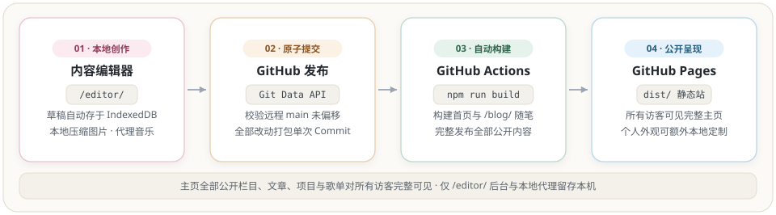

<div align="center">

# Kotori's Homepage

<p><em>「そして始まる、きみとはぐ、のセカイ!」</em><br>日系画册风个人主页、随笔文集与项目驿站</p>

<p>
  <a href="https://kotori-cjk.github.io/">在线访问</a> ·
  <a href="https://kotori-cjk.github.io/space/">Colorful Seika Space</a> ·
  <a href="https://kotori-cjk.github.io/recite/">课程背诵</a> ·
  <a href="https://github.com/Kotori-cjk/HomePageEditor">HomePageEditor</a>
</p>

<p></p>
<p><sub>夜灯、书页与微风——在纸页翻落间，翻开一本静谧的个人画册。</sub></p>

</div>

---

## 概览

`Kotori's Homepage` 是一个无框架、纯静态构建的个人主页。站点以日系画册与硬壳翻书为序章，将个人简介、兴趣切片、Markdown 随笔、手选项目与网易云公共唱片机收拢在同一页温暖的纸面之上；同时保留仅运行于本机的 `/editor/` 工作室，令内容更新如整理手账般从容。

---

## 画册风貌

- **翻书序章**：由 `StPageFlip` 驱动的立体开合封面，展开后呈现细腻纸感与柔光叠层。
- **随笔专栏**：`content/posts/*.md` 经 `gray-matter` 与 `markdown-it` 构建为独立文章页 `/blog/<slug>/`，自动生成侧栏文章目录（TOC）与阅读进度条；标记 `draft: true` 的草稿不参与公开。
- **兴趣、项目与外链**：由 `content/site.json` 与 `content/projects.json` 结构化驱动，随站点构建一并渲染。
- **浮动唱片机**：读取 `content/music.json` 挂载网易云音乐外链播放器，折叠时保持播控状态，并为 VIP 或版权受限曲目提供直达跳转。
- **访客个人外观**：访客可在主页「设置」中上传仅存留于当前浏览器 `IndexedDB` 的个人封面与背景，并支持 JSON 导入导出，与公共默认视觉互不干扰。

---

## 内容工作流

<picture>
  <source media="(prefers-color-scheme: dark)" srcset="docs/workflow-dark.svg">
  <source media="(prefers-color-scheme: light)" srcset="docs/workflow-light.svg">
  
</picture>

主页所有公开内容（简介、兴趣、随笔、项目、链接、公共歌单与默认视觉）都会随构建完整上线，保证每位访问者都能看到完整主页；同时可在本地 `/editor/` 中整理并发布新内容（草稿自动存于 `IndexedDB`）：

1. **网易云解析**：`npm run editor` 附带仅限本机访问的代理接口，粘贴歌曲链接即可自动识别曲名、歌手并下载封面。
2. **安全鉴权发布**：发布时仅在页面内存中临时使用仅授权 `Kotori-cjk/Kotori-cjk.github.io`（`Contents: read/write`）的 fine-grained token，不落盘、不写入 URL 或仓库。
3. **防覆盖原子提交**：写入前校验远程 `main` 是否变动，确认无误后经 Git blobs / trees / commits / refs API 将全部改动打包为单次 commit。

---

## 本地构建与预览

```powershell
npm install --cache .npm-cache
npm run editor
```

| 入口 | 地址 | 说明 |
| --- | --- | --- |
| 主站预览 | `http://localhost:8000/` | 完整画册页面与静态构建文章 |
| 本地编辑器 | `http://localhost:8000/editor/` | 站点资料、随笔、项目、歌单与素材库管理 |

> 线上 GitHub Actions 使用 `npm run build` 构建至 `dist/`，**不会**把 `/editor/`、编辑器入口或本地网易云代理部署到公开站点。

---

## 目录与内容结构

| 路径 | 用途 |
| --- | --- |
| `content/site.json` | Hero 文案、自我介绍、兴趣切片、外部链接与公共默认视觉 |
| `content/projects.json` | 手选公开项目卡片 |
| `content/music.json` | 公共网易云唱片机曲目清单 |
| `content/posts/*.md` | 博客 Markdown 源文件（支持 `draft: true`） |
| `assets/uploads/` | 经编辑器上传并压缩后的公共图片素材 |
| `editor/` · `scripts/build.mjs` | 本地内容工作室与静态站生成器 |

---

## 部署排查与致谢

- **GitHub Pages 设置**：仓库 **Settings → Pages** 需将 Source 设为 **GitHub Actions**，并确认 `Deploy Homepage` 工作流构建成功。
- **本地排障**：若部署构建异常，可先在本地执行 `npm ci` 与 `npm run build` 复现；请勿直接手动修改 `dist/`。
- **资源署名**：开源组件与封面插画授权详情见 [assets/ATTRIBUTION.md](assets/ATTRIBUTION.md)。
